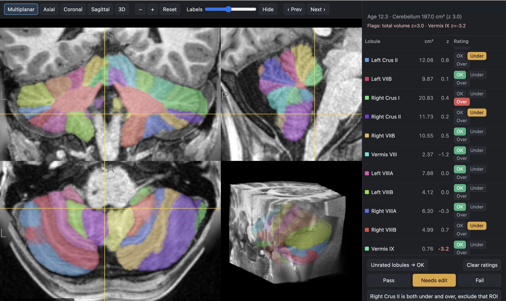

# ACAPULCO Cerebellum QC

An interactive, lobule-level quality-control tool for [ACAPULCO](https://iacl.ece.jhu.edu/index.php/Cerebellum_CNN) cerebellar parcellations. Raters review each subject in a browser, mark each of the 28 regions as OK, Under, or Over, and give an overall Pass, Needs edit, or Fail. Ratings are saved per lobule, so analyses can drop a single bad region instead of a whole subject.

## Why lobule-level QC

Most ACAPULCO errors affect one or a few lobules, not the whole cerebellum. Excluding every subject with any error throws away good data, and the losses are not random: segmentation fails more often in people with lesions, atrophy, motion, or unusual anatomy, which are often the people a clinical study most needs to keep. Subject-level exclusion therefore shrinks samples and can bias them toward healthier participants.

This tool keeps as much data as possible by recording problems where they occur:

- **Overinclusions** (labels extending past the cerebellum into CSF, brainstem, cortex, or bone) are easy to see and can be removed by hand, for example in ITK-SNAP. A subject with any overinclusion is marked **Needs edit**.
- **Underinclusions** (labels stopping short of the cerebellar edge) cannot be filled in reliably, because that would require placing boundaries between lobules. They are recorded, and the subject still **Passes**.
- A lobule that is **both under and over** is noted and excluded from analysis.
- **Fail** is reserved for segmentations that cannot be judged at all, such as a label placed far outside the cerebellum.

Raters judge only the outer edge of the cerebellum. Borders between lobules are not rated, because placing them correctly takes more detailed neuroanatomy than a QC rater can be expected to have. Full criteria, worked examples, and controls are in [docs/rating_guide.md](docs/rating_guide.md).



A 50-second walkthrough of rating subjects in the app: [docs/ACAPULCO_QC_demo.mp4](docs/ACAPULCO_QC_demo.mp4)

## What is included

| Part | What it does |
| --- | --- |
| `prep/qc_prep.py` | Crops each subject's T1 and native-space labels to the cerebellum (about 250 KB per subject), computes lobule volumes, and flags likely problems. Runs on a cluster or any computer with Python, numpy, and nibabel. |
| `prep/run_prep_slurm.sh` | Template for running the prep as a Slurm job, inside the ACAPULCO container or your own Python. |
| `app/` | The QC app. Runs locally in a browser with standard-library Python only. No installs, no internet, nothing leaves your computer. |
| `tools/make_batches.py` | Splits subjects into one batch per rater, with optional overlap for inter-rater agreement. |
| `tools/merge_ratings.py` | Combines every rater's ratings into one CSV. |
| `examples/make_demo_data.py` | Builds a small synthetic dataset to try the app. |

## Quick start with demo data

```
git clone <this repo> acapulco-qc
cd acapulco-qc
pip install numpy nibabel
python3 examples/make_demo_data.py
python3 app/qc_app.py --data QC_data/demo --rater ME
```

The app opens at http://127.0.0.1:8765. The demo images are geometric shapes with two planted errors (a missing lobule and one lobule absorbing its neighbor).

## Workflow on real data

### 1. Run ACAPULCO

Run ACAPULCO 0.2.1 as usual, one output folder per subject. The prep reads each subject's native-space label image, `<input>_n4_mni_seg_post_inverse.nii.gz`. Things we learned running it at scale:

- **Request enough memory.** High-resolution T1s (0.8 mm) were killed for running out of memory at default cluster settings. 16 GB was enough.
- **Rerun failures into clean folders.** A rerun into a folder holding a crashed run's files can reuse broken intermediates. Delete the subject's output folder before rerunning.
- **Check the native label image, not the volumes CSV.** In our runs, ACAPULCO sometimes wrote the volumes CSV even though the warp back to native space produced an empty label file. Treat a subject as done only when `*_inverse.nii.gz` exists and is not empty.
- **Isolate the container's Python.** Singularity/Apptainer mounts your home folder, so Python can load packages from `~/.local` instead of the container's own. Set `export PYTHONNOUSERSITE=1` before running.

### 2. Run the prep

On a Slurm cluster, edit the settings at the top of `prep/run_prep_slurm.sh` once (account, partition, ACAPULCO output folder, container path), then from the repo folder:

```
sbatch prep/run_prep_slurm.sh MyStudy
```

Or run it directly wherever numpy and nibabel are available:

```
python3 prep/qc_prep.py --seg-glob "/path/to/acapulco/output/MyStudy/*/*_n4_mni_seg_post_inverse.nii.gz" --out QC_data/MyStudy
```

Useful options:

- `--t1-pattern "/data/{sub}/anat/{sub}_T1w.nii.gz"` if the T1 is no longer in each ACAPULCO folder. `{sub}` is replaced by the subject folder name.
- `--demo ages.csv` (columns `subject` and `age`) for age-adjusted flags, which matters in developmental or aging samples.
- `--z-flag 3` sets the flagging threshold in SD units.

The job writes `QC_data/MyStudy/` with the cropped images, `index.json` (read by the app), `flags.csv` (every subject's flags), and `skipped.csv` (subjects whose ACAPULCO run did not finish). Rerunning reuses subjects already cropped, so it is fast after the first run.

**Flags** point raters at likely problems. A subject is flagged when a lobule is missing, when a lobule's share of total cerebellar volume is more than 3 SD from the dataset (age-adjusted if ages are given), or when total cerebellar volume is more than 3 SD off. Flagged subjects are listed first in the app. A flag is not a rating: many flagged subjects turn out fine.

### 3. Copy the QC folder to your computer

The app runs on the rater's own computer, where image viewing is fast. From the repo folder on your computer:

```
mkdir -p QC_data
rsync -av you@cluster:/path/to/acapulco-qc/QC_data/MyStudy/ QC_data/MyStudy/
```

Keep the trailing slash on both paths. rsync copies only new and changed files and never touches the `ratings` folder you build locally, so it is safe to rerun after updating the prep. If the connection times out off campus, connect your institution's VPN or download a zipped copy through your cluster's web portal. A dataset of 600 subjects is about 150 MB.

### 4. Rate

```
python3 app/qc_app.py --data QC_data/MyStudy --rater <your initials>
```

Ratings save automatically to `QC_data/MyStudy/ratings/ratings_<initials>.csv` (and a `.json` the app reloads from). Stop with Ctrl-C and restart anytime. See [docs/rating_guide.md](docs/rating_guide.md) for controls and criteria.

### 5. Several raters

Each rater uses their own initials and saves only to their own file, so nobody can overwrite anyone else. To split the work:

```
python3 tools/make_batches.py --data QC_data/MyStudy --raters AB CD EF --overlap 10
```

This writes `batch_MyStudy_AB.txt` and so on. Subjects are dealt out in turn so every batch gets a similar mix of sites and flagged cases. `--overlap 10` gives every rater the same 10 extra subjects for checking agreement. Each rater starts the app with their batch:

```
python3 app/qc_app.py --data QC_data/MyStudy --rater AB --subjects batch_MyStudy_AB.txt
```

If a rater's `ratings_<initials>.json` is placed in another rater's `ratings` folder, the app shows who has rated each subject and offers a "Not yet rated by anyone" filter.

### 6. Merge

Copy every rater's `ratings_*.json` into `QC_data/MyStudy/ratings/`, then:

```
python3 tools/merge_ratings.py --data QC_data/MyStudy
```

This writes `QC_data/MyStudy/ratings_all.csv`, one row per subject per rater, and reports subjects rated by more than one person and subjects nobody rated.

## Using the ratings

The ratings file has one column per lobule (`OK`, `Under`, `Over`, or blank), an `overall` column, `notes`, and the automated flags. A typical analysis plan:

| Overall | Lobules kept |
| --- | --- |
| Pass | All. Underinclusions are recorded but kept. |
| Needs edit | Edit the overinclusions and recompute volumes, or exclude the lobules rated Over. |
| Fail | None. Exclude the subject. |

In every case, exclude lobules noted as both under and over. Search the `notes` column for "exclude".

## Requirements

- **Prep:** Python 3.6 or newer with numpy and nibabel. The ACAPULCO 0.2.1 container includes both.
- **App and tools:** Python 3.6 or newer, standard library only, and a modern browser with WebGL (Chrome, Firefox, Safari, Edge).

## Privacy

The app serves files only to your own computer (127.0.0.1), makes no network requests, and stores ratings as plain files next to the data. Cropped images are still participant data: keep `QC_data/` off public storage and follow your data use agreements. The included `.gitignore` keeps `QC_data/` and batch files out of git.

## Citation

If you use this tool, please cite ACAPULCO:

Han S, Carass A, He Y, Prince JL. Automatic cerebellum anatomical parcellation using U-Net with locally constrained optimization. *NeuroImage*. 2020;218:116819.

The viewer is built on [NiiVue](https://github.com/niivue/niivue) (BSD 2-Clause, see `THIRD_PARTY_NOTICES.md`).

## License

See `LICENSE`.
