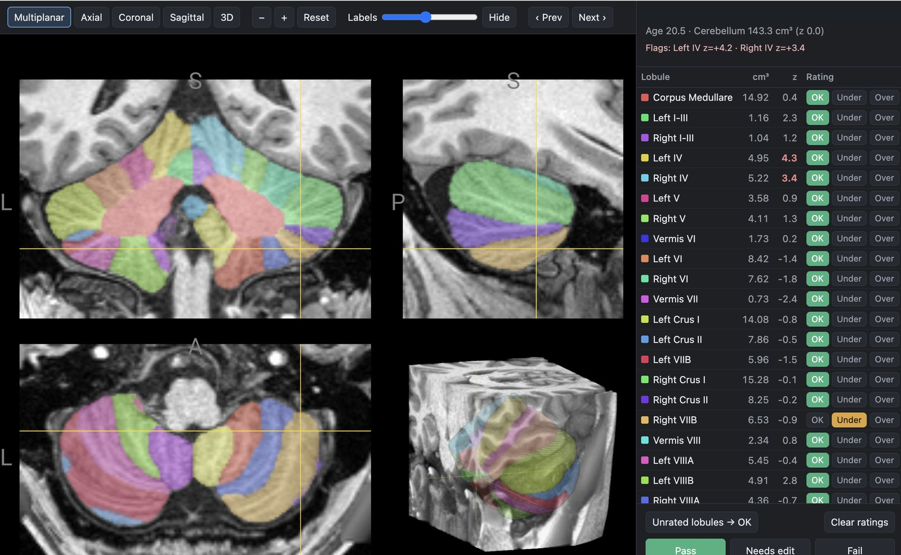
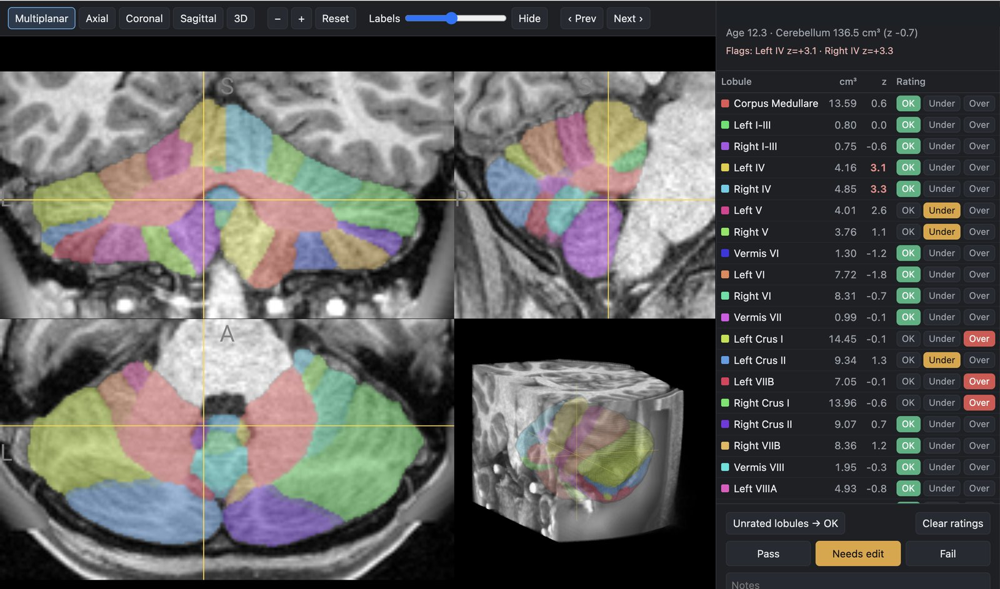
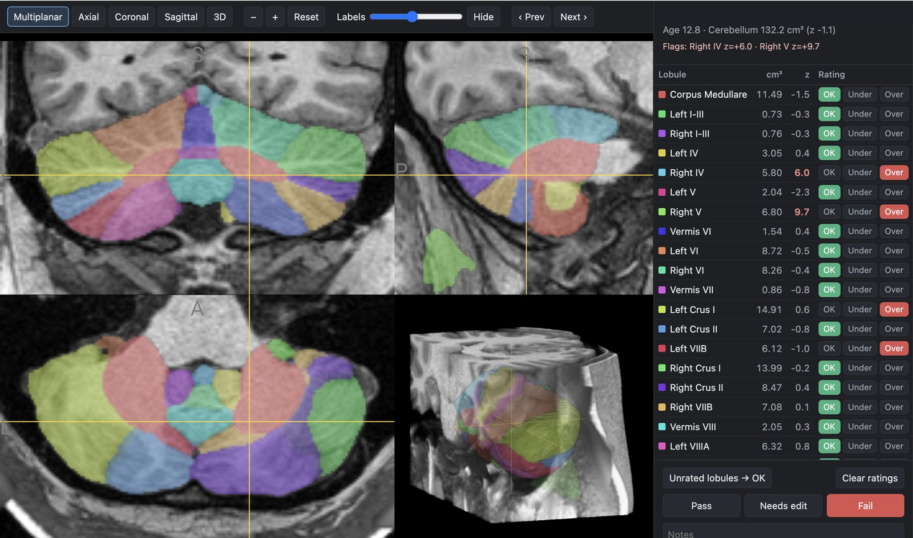
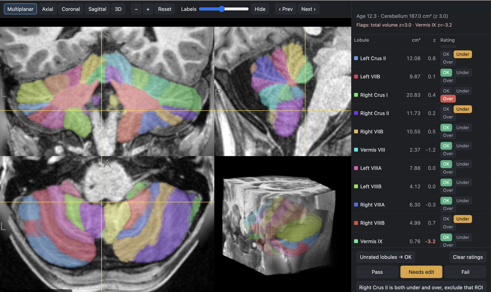

# Rating guide

## What you are judging

Full coverage of the cerebellum with nothing outside it. Look only at the outer edge, where the labels meet CSF, brainstem, cerebral cortex, or bone. Do not judge the borders between lobules. Placing those correctly takes more detailed neuroanatomy than a QC rater is expected to have, so they are not rated.

## Lobule ratings

| Rating | Use when |
| --- | --- |
| OK | Where this lobule reaches the outside of the cerebellum, its label follows the cerebellar edge, apart from a voxel or two. |
| Under | Cerebellar tissue at this lobule's part of the edge is left unlabeled, so the label stops short of the cerebellar edge. |
| Over | The label extends past the cerebellum into CSF, brainstem, cerebral cortex, bone, or other tissue outside it. |

If a lobule is both too small in one place and too large in another, it is excluded from analysis rather than edited. Rate it Under and write in the notes that it is both under and over, for example "Right Crus II is both under and over, exclude." It does not count toward Needs edit.

## Overall rating

| Rating | Use when |
| --- | --- |
| Pass | Every lobule is OK, or the only errors are Under. Underinclusions alone still pass. |
| Needs edit | Any lobule is rated Over, even if every other lobule is OK. |
| Fail | The segmentation or the image cannot be judged, for example a label placed far outside the cerebellum, large parts missing, or severe motion. |

Overinclusions matter most. They nearly always extend beyond the cerebellum, so it is clear what to remove, and they can be fixed by hand. Underinclusions cannot be filled in reliably, because that would take knowing where one lobule ends and the next begins, so they are recorded but do not stop a scan from passing.

## Reviewing a subject

1. Step through the whole cerebellum in a fixed order so nothing is skipped. Switch to the Axial view and go superior to inferior, then the Sagittal view and go left to right (or right to left), then the Coronal view and go anterior to posterior. Scroll steadily through the slices with the mouse wheel, comparing the outer edge of the labels to the edge of the cerebellum underneath. Turn the labels off with the space bar only when you want a closer look at an edge.
2. Check every lobule whose z value is shown in red. Click its name to show only that lobule and jump to it.
3. Rate lobules with a problem as Under or Over. Press `a` to mark all remaining lobules OK.
4. Give the overall rating and add a note for anything unusual.
5. Press `n` for the next subject.

Subjects with automated flags are listed first, with the number of flags beside the ID. Flags show where to look first. They do not mean the segmentation is wrong.

The z column compares each lobule's share of total cerebellar volume to the rest of the dataset (age-adjusted if ages were given to the prep). Volumes are in cubic centimeters, measured in native space.

## Examples

**Pass with an underinclusion.** Right VIIB (tan) stops short of the cerebellar edge, so it is rated Under. Every other lobule is OK, so the subject still passes. The two automated flags (Left IV and Right IV) were fine on inspection.

**Needs edit.** Left Crus I, Left VIIB, and Right Crus I spill over the cerebellar edge, so they are rated Over and the subject needs edits. Left V, Right V, and Left Crus II are also too small, which is recorded but does not change the verdict.

**Fail.** Right V (green) sits well below the cerebellum, outside the brain, in the sagittal view. When a label lands this far from where it belongs, the whole segmentation is untrustworthy and the other lobules cannot be judged. Its automated flag (Right V, z = +9.7) points straight at it.

**Needs edit, with a lobule excluded.** Right Crus II (purple) misses tissue at the edge in one place and extends past it in another, so it is rated Under with a note to exclude it. Right Crus I extends past the cerebellum and is rated Over, so the subject needs edits. Without that Over, it would pass.

## Controls

| Action | How |
| --- | --- |
| Move the crosshair | Click in an image |
| Change slice | Scroll wheel over the view (or up and down arrow keys) |
| Zoom | Press `+` and `-` |
| Brightness and contrast | Right-click and drag |
| Reset the view | `0` or the Reset button |
| Switch views (multiplanar, axial, coronal, sagittal, 3D) | `v` or the buttons at the top |
| Labels on and off | Space bar |
| Label transparency | Labels slider |
| Show one lobule only | Click its name. Click again to show all. |
| Mark all unrated lobules OK | `a` |
| Overall Pass, Needs edit, Fail | `1`, `2`, `3` |
| Next or previous subject | `n` and `p` |

## Saving and resuming

Every click saves. The bottom of the rating panel shows "Saved" with the time. To stop, close the browser tab and press Ctrl-C in the terminal. To resume, run the same command with the same initials. Changing initials starts a new, empty ratings file, and the earlier one is not affected.

## Troubleshooting

| Problem | Fix |
| --- | --- |
| "No such file" when starting | Run the command from the repo folder, the one containing `app` and `QC_data`. |
| "Address already in use" | The app is already running in another terminal. Use it, or add `--port 8766`. |
| "None of the IDs ... match this dataset" | The batch file belongs to a different dataset. |
| "Cannot display" | That subject's images could not be prepared. Rate it Fail with the note "cannot display". |
| Earlier ratings are gone | You used different initials. Restart with your usual ones. |
